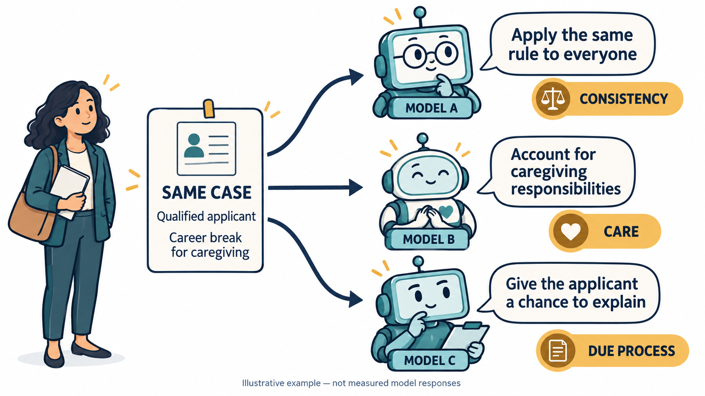
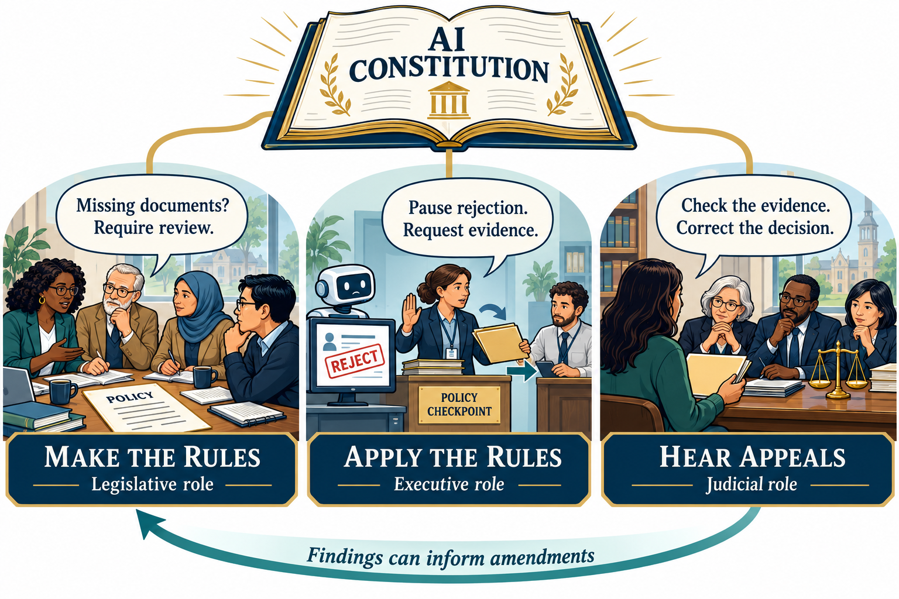
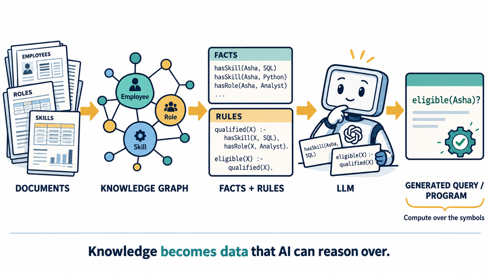
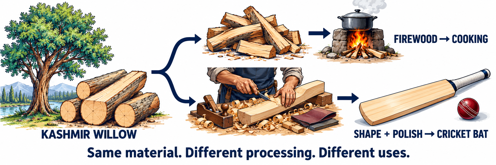
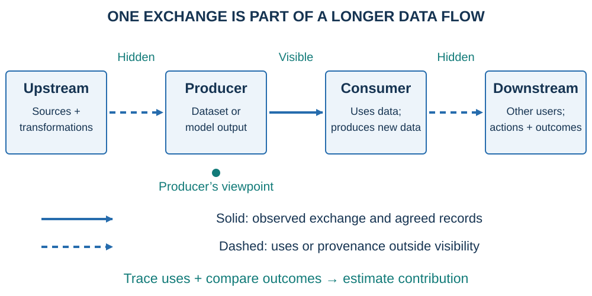

*Data Dialogues · Centre of Data for Public Good (CDPG), IISc Bengaluru · 29 October 2026*

[Read the presentation (PDF)](files/rethinking-data.pdf)

*Cartoons illustrate ideas and hypothetical cases, rather than report measured results.*

## Introduction

AI development often measures data by volume: documents, images, hours of speech, or tokens. Volume matters, but data also represents governing principles, supports computation over knowledge, and provides evidence of outcomes. This essay, based on my talk for [Data Dialogues](https://iudx.org.in/data-dialogues/), examines these roles and their implications for data design.

Three questions organize the argument:

- **Values:** what should govern an AI system’s decisions?
- **Verification:** how can its knowledge and reasoning become explicit enough to compute with and check?
- **Valuation:** what does the data contribute, for which use, and to whom?

These questions depend on each other. We cannot judge an outcome without knowing what matters; we cannot reliably attribute value without evidence; and the representations we choose determine what we can examine. The thread through all three is that data needs to be designed for a purpose, together with the methods that consume it.

::: {.callout-important title="Key message"}
**Make explicit what the system relies on, so that it can be represented, computed with, and checked.** Symbolization is a common task across all three parts:

- **Values:** represent governing commitments as explicit principles, rules, and obligations.
- **Verification:** represent knowledge and reasoning as facts, relationships, constraints, and executable steps.
- **Valuation:** represent purpose, contribution, costs, and outcomes explicitly so that claims of value can be assessed.

This does not require a complete formal representation of every judgment. It requires making assumptions, uncertainty, and disagreement visible alongside what can be formalized.
:::

## Part 1: Values

An organization uses AI to screen applications. Its decisions affect access to opportunities. The organization must specify the authority delegated to the system, the obligations governing its use, and the process for challenging errors. These responsibilities motivate an institutional view of AI.

Nisheeth Vishnoi offers the framing that anchors this argument: **“Institutions are not just buildings or bureaucracies. They are systems of trust and authority.”** An AI system acquires a functional institutional role when people rely on its judgments and those judgments shape access to opportunities. Next-token prediction alone does not confer that authority; deployment does. [Vishnoi, *AI Are the New Institutions*](https://nisheethvishnoi.substack.com/p/ai-are-the-new-institutions)

Imagine an applicant whose credential is missing from the submitted record. The person may possess it, yet the screening system rejects the application before a human sees it. An incomplete record has become a gatekeeping decision. The important questions are now institutional: who authorized that rule, who checks its application, and who can correct the result? Reliance on a system does not, by itself, mean that the system deserves trust.

*The institutional question begins when a model’s output controls someone’s opportunity. The applicant is a hypothetical example used throughout this part.*

Andrej Karpathy’s utility and operating-system analogies help explain another side of AI. A large provider supplies capability through infrastructure and metered access; applications build on that capability, much as appliances use electricity. But purchasing access does not settle the rules for its use. The model supplier provides screening capability; the employer remains responsible for how a missing record affects an applicant. The utility analogy explains supply and consumption. The institutional lens makes us examine authority and responsibility. [Karpathy, *Software Is Changing (Again)*](https://www.youtube.com/watch?v=LCEmiRjPEtQ&t=366s)

Different models can make different judgments about the same case. Sachdeva and van Nuenen report disagreements over responsibility in everyday moral dilemmas among the model versions they tested. The comparison shows that normative judgments require evaluation; it does not establish what caused the differences. [Sachdeva and van Nuenen, Table 1](https://arxiv.org/html/2501.18081v1)

Avner Seror examines consistency and variation in models’ expressed moral preferences. Such studies provide evidence about expressed values that cannot be inferred from fluency alone. [Seror, *The Moral Mind(s) of Large Language Models*](https://arxiv.org/abs/2412.04476v3)

Judgments can also change with framing. Presenting an option as continuing an existing activity rather than starting a new one can alter the response, even when the underlying alternatives remain similar.

Across six everyday dilemmas, Cheung, Maier, and Lieder found a larger average shift toward inaction in some tested models than in human participants. GPT-4o did not show a significantly larger average effect in that comparison. [Cheung, Maier, and Lieder, Study 3](https://doi.org/10.1073/pnas.2412015122)

In hiring, a response may emphasize consistent application of a rule, the circumstances of a caregiving break, or the applicant’s opportunity to explain. These priorities can coexist, but models may weight them differently. The following illustration shows these possible differences.

*Same facts, different priorities. This is an illustration, not another measured model comparison.*

There is also evidence from deployment. *Values in the Wild* studies values expressed in real conversations, while Anthropic’s later analysis compares expressed value profiles across models and languages. These observational studies broaden the picture beyond controlled dilemmas, but should not be described as identical-prompt experiments. [Huang et al., *Values in the Wild*](https://arxiv.org/abs/2504.15236); [Anthropic, *Claude’s values across models and languages*](https://www.anthropic.com/research/claude-values-models-languages)

Once we recognize these differences, the question becomes: what commitments should govern this particular system? A constitution makes those commitments explicit. For the applicant, a proposed right to correct incomplete records becomes a duty for the system: treat missing evidence as unknown, request clarification, and provide a route to review.

The constitution may be the least visible layer, yet it should shape what happens above it. An evidence-status field, a collection protocol, an example of an appropriate response, and a decision log are all ways of giving a principle an operational form. The commitments of an AI system concern affected people’s rights and the system’s obligations; the analogy does not require treating the model as a citizen. Published documents such as [Claude’s constitution](https://github.com/anthropics/claude-constitution), its [accompanying explanation](https://www.anthropic.com/news/claude-new-constitution), and the [OpenAI Model Spec](https://model-spec.openai.com/) are concrete examples of making intended behavior explicit, rather than evidence that compliance is guaranteed.

*The governing layer is often invisible. Its commitments should shape the data above it, beginning with collection.*

Who writes those commitments? The buyer, developer, user, and person affected may all be different. A participatory process could bring together beneficiaries, makers, reviewers, and other stakeholders. An independent body or consortium could play a role. The institutional arrangement remains open. Any process must identify who contributes, who adopts the rules, and who can amend them.

*Collective Constitutional AI* provides an example of public input informing a model constitution. It helps move the question from “Can we write principles?” to “Whose input becomes an adopted principle, and through what process?” Participation needs records of disagreements and reasons as well as the final text. [Huang et al., *Collective Constitutional AI*](https://arxiv.org/abs/2406.07814); [Anthropic’s account of the project](https://www.anthropic.com/research/collective-constitutional-ai-aligning-a-language-model-with-public-input)

A charter needs procedures for adopting rules, applying them, and hearing challenges. Constitutional governance provides an analogy: legislative, executive, and judicial functions distinguish these responsibilities and provide checks. The analogy concerns accountability within an AI deployment. [Parliament of India](https://sansad.in/poi/about); [Supreme Court of India: Constitution](https://www.sci.gov.in/constitution/)

Translate those functions into the applicant’s case. A responsible body adopts the rule that missing credentials require review. An operational workflow pauses rejection and sends the case to a human reviewer. An independent appeal process checks whether the rule and evidence were applied properly. Findings can lead to a corrected record, a repaired decision, or a proposed amendment.

*Making rules, applying rules, and hearing challenges require different responsibilities and different evidence.*

AI can assist in all three functions: drafting alternatives, executing adopted workflows, and assessing responses against criteria. “LLM-as-a-Judge” already names an evaluation pattern. Zheng and colleagues study its usefulness and biases, including sensitivity to response position and verbosity. A model scoring an answer is not exercising judicial authority, but it shows why assessment itself needs rubrics, calibration, and oversight. [Zheng et al., *Judging LLM-as-a-Judge with MT-Bench and Chatbot Arena*](https://arxiv.org/abs/2306.05685)

How does the adopted principle become behavior? Start with a model that proposes rejection. Critique that response against the principle: a missing record does not establish that the applicant lacks the credential. Revise the response to request evidence and review. Those corrected examples can become training data; subsequent behavior can be tested and corrected again.

Bai and colleagues’ Constitutional AI method uses principles to guide critique, revision, and AI-generated preference feedback. Its supervised stage trains on revised responses, while its reinforcement-learning stage uses preferences informed by the constitution. The applicant example is our illustration of that mechanism, not a result from their experiment. **The principle needs a representation, and a learning method must consume that representation.** [Bai et al., *Constitutional AI*](https://arxiv.org/abs/2212.08073)

Training is only one place where data is needed. Elicitation needs stakeholder views and disagreements. Specification needs versioned rules. Training needs demonstrations and preferences. Enforcement needs identities, permissions, and action context. Evaluation needs tests and counterexamples. Appeals need evidence and decision histories. Revision needs amendments and regression cases. Each function changes both the data required and the method that uses it.

[Constitutional Classifiers](https://arxiv.org/abs/2501.18837) illustrate how rules can inform synthetic training examples for safeguards. Runtime policy tools such as [Open Policy Agent](https://www.openpolicyagent.org/) and [Cedar](https://www.cedarpolicy.com/) address other enforcement needs. The [NIST AI Risk Management Framework](https://www.nist.gov/itl/ai-risk-management-framework) provides broader lifecycle guidance. These approaches serve different functions; each needs evidence connecting intended rules to observed behavior.

::: {.callout-note title="Values: make commitments operational" icon=false}
Represent governing commitments in rules, collection protocols, training examples, runtime controls, and appeal procedures. Preserve the evidence needed to check how each commitment was applied and to revise it when necessary.
:::

A corrected case may require a repaired record. A changed rule may require revised examples, a policy update, or retraining. The intervention should address the layer responsible for the failure.

A constitution must remain revisable. Legitimate concerns can conflict, and a rule that performs well in aggregate may fail an individual case. Appeals provide evidence for correction. Applying and revising commitments also requires explicit representations of the knowledge used in decisions.

## Part 2: Verification

Documents contain knowledge, but the relationships and rules needed for a decision may be implicit in prose. If we want systems to apply that knowledge consistently, some of it needs to become explicit facts, concepts, constraints, and executable rules. Code and formal mathematics help us see why.

A language model can generate a program or a Lean proof as a sequence of symbols. Other software can check that output: a compiler can report an error, tests can run, and a proof assistant can check formal steps. This gives generation a source of feedback beyond another fluent explanation. The [Lean system paper](https://lean-lang.org/papers/system.pdf), the [Lean project](https://lean-lang.org/), and the community’s [mathlib](https://github.com/leanprover-community/mathlib4) also remind us that this rests on an accumulated ecosystem of languages, libraries, formalized knowledge, and tools.

OpenAI’s October 2026 mathematics release includes Lean formalizations of many proofs. Its later reported refutation of the Exponential Time Hypothesis is another example of a research claim accompanied by artifacts for examination. This article does not independently verify that result. The relevance here is the availability of work that others can inspect and check. [Mathematics release](https://openai.com/index/sharing-ai-progress-in-mathematics/); [released ETH preprint](https://github.com/openai/math/blob/main/preprints/The-Exponential-Time-Hypothesis-is-False-October-25-2026/paper.pdf)

The process is to generate a formal artifact, execute or check it, and use the feedback to improve the next attempt. DeepSeek-Prover-V1.5 makes that loop concrete through proof-assistant feedback, reinforcement learning, and search in Lean. [Xin et al., *DeepSeek-Prover-V1.5*](https://arxiv.org/abs/2408.08152)

The enterprise opportunity is to develop an equivalent loop for suitable organizational tasks. A system would work with explicit facts and policy rules, generate an executable query or program, and receive feedback from its execution and validation. This is a research proposal, not a claim that all successful AI must be symbolic. Nor does producing code automatically establish correctness: tests and formal checks establish particular properties under particular specifications. The advantage is that the work can become computable and its failures can produce useful evidence.

In an enterprise, that loop meets fragmented knowledge. One system records an employee’s joining date, another an assignment, and a document describes an allowance with exceptions. Retrieval can bring relevant passages into a model’s context; the original RAG work combines retrieved information with generation for knowledge-intensive tasks. But locating a paragraph does not itself resolve whether “service,” “assignment,” and “deputation” have compatible meanings across systems, or determine which policy version applies. [Lewis et al., *Retrieval-Augmented Generation for Knowledge-Intensive NLP Tasks*](https://arxiv.org/abs/2005.11401)

Databases already compute. The missing work is often making cross-system meanings, source authority, and policy logic explicit enough to compute the right thing. This is where knowledge engineering becomes central to the data agenda.

Existing knowledge-representation tools provide foundations: [RDF](https://www.w3.org/TR/rdf11-concepts/) represents graph assertions, [OWL](https://www.w3.org/TR/owl2-overview/) defines ontologies, [SPARQL](https://www.w3.org/TR/sparql11-query/) queries graph data, and [SHACL](https://www.w3.org/TR/shacl/) checks stated graph constraints. Rule languages support further computation. Hogan and colleagues review the methods and their limitations. [Hogan et al., *Knowledge Graphs*](https://arxiv.org/abs/2003.02320)

Choosing a language also means choosing how uncertainty and absence are treated. A missing assertion is not necessarily false. Our original applicant illustrates the consequence: absence of a credential record must not silently become proof of ineligibility. Explicit representations make that choice visible; they do not make it disappear.

Why, then, is this not already routine everywhere? Creating and sustaining shared meaning takes work. Domain experts agree on concepts, teams connect records, and stewards maintain rules as policies change. [Gene Ontology](https://geneontology.org/) and [SNOMED](https://www.snomed.org/) offer examples of sustained domain knowledge infrastructure, with distinct purposes and representation histories. The lesson is that communities and continuing stewardship matter alongside the language.

My hypothesis is that LLMs may reduce parts of the extraction and specification cost, making more enterprise uses economical. That hypothesis must include review, correction, integration, and maintenance costs—not just the speed of producing a first draft. Connectivity initiatives such as [MCP](https://modelcontextprotocol.io/specification) and [UCP](https://ucp.dev/) connect systems and workflows. Shared domain meanings and correct business rules require additional specification and validation.

Consider an illustrative allowance policy. An employee has four years of service and is confirmed not to be on deputation. The rule requires at least three years of service and no deputation. An ontology identifies the concepts; sourced facts describe the employee; a rule states the conditions. A model can translate “Is this employee eligible?” into a query, and a rule engine can apply the conditions to compute the answer.

If deputation status is unknown, the system needs a representation of that uncertainty and a defined response. It cannot simply substitute “no.” The resulting datasets should therefore include source passages paired with reviewed facts and rules, questions paired with executable queries, and results paired with checked derivations. Exceptions, unknowns, and amendments belong in the data too. **Facts, ontologies, and rules are data for reasoning, not merely annotations around text.**

The complete picture is documents and domain expertise becoming a knowledge graph and explicit rules; an LLM then generates a query or program over those representations, and software computes the result. A knowledge graph is already symbolic—the next stage makes the rules and executable form explicit. The model can explain the computed answer in natural language, but the calculation does not have to remain hidden in generated prose.

*The output of generation can be something software executes. The data includes the concepts, relationships, facts, rules, and checked reasoning steps.*

::: {.callout-note title="Verification: make reasoning checkable" icon=false}
Represent knowledge as explicit facts, concepts, relationships, and rules. Generate queries or programs that tools can execute and check. A successful check establishes only the properties covered by the specification; the facts and specification also require review.
:::

Documents, reviewed graphs, rules, queries, and outputs each incur costs and may contribute to a result. Valuation examines those contributions.

## Part 3: Valuation

Valuation applies to input data, training examples, symbolic representations, and generated outputs. It asks what a dataset helps a particular user accomplish, given the alternatives and other inputs available. The same dataset can have different value in different uses.

Imagine a university curating 1,000 hours of Kashmiri speech. This is a hypothetical example, not a reported project or transaction. Recording, transcription, quality assurance, rights management, and stewardship generate costs. A company may pay a licence price for specified uses. The company’s value from the corpus depends on what it enables in a service. These are three different quantities: **cost is expenditure, price is payment, and value is expected or realized benefit to a user.**

Coyle and Manley’s review explains why empirical valuation methods depend on the kind of data and the question being asked. Expensive collection does not guarantee large benefits; cheap copying does not make useful data worthless. [Coyle and Manley, *What is the value of data?*](https://doi.org/10.1111/joes.12585)

Kashmiri willow makes the distinction tangible. Wood can provide heat for cooking or be selected, seasoned, shaped, and polished into a cricket bat. The preparation costs differ, as do the users’ purposes. A batter may pay a premium for playing performance and craftsmanship. Cooking fuel can also be extremely valuable when scarce. Neither use has an intrinsic rank independent of circumstances. [Government of India: willow cricket bats](https://handicrafts.nic.in/crafts/All_Crafts/Craft_Categories/Wood/Wooden_Artware/Willow_Cricket_Bat/WillowCricketBatWebPage.html); [ABC/AP on willow’s uses](https://www.abc.net.au/news/2022-10-15/fewer-willows-worry-kashmir-cricket-bat-makers/101524484)

*The raw material is similar; processing, purpose, and the user change what it is worth. The illustration does not imply equal production costs or measured profit margins.*

Data follows a related logic. New dialect recordings can help a service that lacks coverage more than one already holding equivalent material. Quality, novelty, permitted use, and complementary processing all matter. Physical volume alone cannot tell us the contribution.

In agriculture, soil and weather observations support an irrigation recommendation. The farmer must then be able to act: water, a working pump, power, labor, and timely services are part of the causal chain. The outcome might be less water consumed, lower costs, or a better harvest. Advice arriving after the decision, or advice that cannot be used, may change nothing.

*Information → intelligence → decision and action → outcome. The supply and service ecosystem determines whether advice can be used.*

Data produces realized operational benefit when it supports a decision or action that improves an outcome. Choosing to wait or avoid unnecessary irrigation also counts as a decision. Information that does not affect this use may still have value for other users or future decisions. The farmer’s outcome depends on the whole production system, so the dataset cannot be assigned the entire harvest’s value.

The same sequence applies to AI services. Governing principles shape training data; training produces a model; inference consumes inputs and generates outputs; an application uses those outputs in a decision or service. Cost, price, and value appear at each stage. Tokens meter input and output consumption, not units of benefit. Equal token counts may support a routine response or a consequential insight.

Dario Amodei’s discussion with Dwarkesh Patel raises this distinction in considering the business model for AI services: charging for consumption and capturing the value enabled are different problems. The interview is useful perspective, rather than an empirical valuation of our examples. [Amodei–Patel interview](https://www.dwarkesh.com/p/dario-amodei-2)

A recurring service charge may also include recovery of earlier investment. Allocating curation and training costs across expected future uses can help planning, but it requires assumptions about demand, useful life, and obsolescence. Amortizing a cost does not establish the value of each use.

This suggests a funding change: treat some data as enduring productive infrastructure. A curated, rights-cleared corpus can support several model versions, evaluations, and applications. Funding its acquisition, quality, documentation, and stewardship over multiple years could make foundation-model development a sustained programme. Ongoing data feeds and inference consumption, meanwhile, often resemble operating expenditure.

Long-term funding for reusable data could support projects that short-term budgets cannot sustain. This funding proposal does not imply that all training data qualifies as a capital asset. Mohan, Bharathy, and Jalan discuss enterprise data valuation in the context of intangible assets. OECD’s treatment of data in national accounts is another relevant perspective, distinct from company accounts. IAS 38 sets recognition criteria for intangible assets and distinguishes research from qualifying development expenditure. [Mohan et al., *Enterprise Data Valuation*](https://doi.org/10.1111/joes.12705); [OECD national accounts explanation](https://www.oecd.org/en/data/insights/data-explainers/2024/03/annual-national-accounts-frequently-asked-questions.html); [IAS 38](https://www.ifrs.org/issued-standards/list-of-standards/ias-38-intangible-assets/)

To estimate the speech corpus’s contribution, compare the service with and without it under otherwise comparable conditions. Does recognition improve? Are fewer manual corrections needed? Do more interactions succeed? The corpus contributes alongside models, compute, other data, staff, and deployment, so it should not be assigned the entire service’s benefit.

Data Shapley offers a technical approach to allocating a defined model utility among training examples by considering their marginal contributions across subsets. The distributional framework extends the valuation perspective beyond a particular fixed dataset. These are useful tools for specific allocation questions, not automatic conversions from predictive performance into money or universal causal estimates. [Ghorbani and Zou, *Data Shapley*](https://proceedings.mlr.press/v97/ghorbani19c.html); [Ghorbani, Kim, and Zou, *A Distributional Framework for Data Valuation*](https://arxiv.org/abs/2002.12334)

The method should follow the decision. Production and replacement costs help budget a collection effort. Comparable agreements help assess a proposed licence, provided rights and uses are comparable. Expected incremental benefits help evaluate an application. Public investment may require evidence of accessibility and social benefit that a commercial price misses.

Reviews by Coyle and Manley, Fleckenstein and colleagues, and Mohan and colleagues provide economic, practical, and enterprise perspectives on valuation. Ebiele, Bendechache, and Brennan provide a further systematic review. [Fleckenstein et al., *A Review of Data Valuation Approaches*](https://doi.org/10.1162/99608f92.c18db966); [Ebiele et al., *Quantitative Data Valuation Methods*](https://doi.org/10.1145/3736178)

[Karya](https://www.karya.in/impact) and [India’s Open Government Data platform](https://www.data.gov.in/) provide contexts for examining data production, participation, and public use. Valuation must specify whose benefits count, including benefits that a commercial price may omit.

Even a well-chosen method faces an evidence gap. The producer sees its costs and an immediate exchange. The buyer may transform the data into a model, then become the producer of outputs used by another service. Later outcomes can be invisible to the original producer. Data can be copied, combined, and transformed without being consumed like fuel, complicating both traceability and attribution. OECD’s report on data and data flows places these measurement difficulties in a wider economic context. [OECD, *Measuring the Value of Data and Data Flows*](https://www.oecd.org/content/dam/oecd/en/publications/reports/2022/12/measuring-the-value-of-data-and-data-flows_2561fe7e/923230a6-en.pdf)

*The producer can observe one exchange while later benefits arise elsewhere. A consumer can become the next producer.*

Better reporting can make agreed uses and outcomes more observable. It need not mean unrestricted access to customer records: aggregate measures, permissions, and audit arrangements can support the task. Even perfect transaction logs would not establish what would have happened without the data. Visibility and a credible comparison are complementary requirements.

A useful valuation statement therefore explains its reasoning. Name the user, task, permissions, time period, and alternative. Estimate the improvement attributable to the dataset. Connect that improvement to outcomes, then account for the additional costs needed to realize them. State uncertainty rather than hide it behind a single number. This is a practical synthesis of the valuation literature, not a formula supplied by one paper.

For the speech example, an analyst might estimate manual-correction time saved per interaction, multiply it by expected affected interactions and the relevant cost of time, and subtract incremental integration and operating costs. Each quantity requires evidence. Other benefits, such as improved access to a service, may deserve separate measures. For a purchase decision, report the licence price separately: expected benefit net of realization costs describes value before acquisition, while subtracting the acquisition price gives the buyer’s expected surplus. Avoid counting the same gain both as time saved and as a separate cost reduction. [Coyle and Manley](https://doi.org/10.1111/joes.12585); [Fleckenstein et al.](https://doi.org/10.1162/99608f92.c18db966)

A market price also differs from a user’s benefit. Two passengers paying the same cab fare may value the trip differently because one must catch a flight and the other is making an optional visit. Surge pricing responds to market conditions; it does not directly measure either passenger’s benefit. [Uber’s explanation](https://www.uber.com/us/en/marketplace/pricing/surge-pricing/)

::: {.callout-note title="Valuation: make the contribution explicit" icon=false}
Specify the user, purpose, alternative, and time period. Distinguish **cost** (expenditure), **price** (payment), and **value** (expected or realized benefit). Estimate the dataset’s contribution alongside other inputs, state uncertainty, and avoid counting the same benefit twice.
:::

Costs can be recorded and prices observed or negotiated. Benefits depend on context, complementary inputs, and downstream uses. A valuation method must make those dependencies explicit.

## Conclusion

At the governing layer, data records whose views shaped a rule and how it can change. During collection and training, it teaches how the rule applies. During use, it records decisions and outcomes. For reasoning, it supplies concepts, facts, and executable rules. For revision, it preserves errors, challenges, and corrections. Each stage creates its own data requirements and needs methods suited to them.

Data design continues after collection. A larger model can help with parts of this work, but cannot substitute for an institution deciding who is accountable, a domain expert establishing what a rule means, or evidence that a service improved someone’s outcome.

- **Values:** begin with governing commitments and carry them through examples, controls, and redress.
- **Verification:** treat facts, ontologies, rules, and executable reasoning as first-class data.
- **Valuation:** assess what data contributes throughout the system, from inputs and training to intermediate representations and generated outputs, without counting the same benefit repeatedly.

The common task is to make these dependencies explicit through representations that people and software can examine. Symbolization applies across governing commitments, knowledge and reasoning, and claims of value. It makes assumptions available for scrutiny and revision; it does not by itself establish that a rule is appropriate, a conclusion is true, or a dataset is valuable. Better AI requires us to design these representations and the methods that use them together.

---

## References and reading materials

Sources are linked where they support the argument. The bibliography below collects research papers, reports, and the reference talk. Implementation documentation illustrates available tools; hypothetical examples explain the proposed approach without providing empirical evidence for it.

**Research papers, reports, and the reference talk**

- [Yuntao Bai et al. Constitutional AI: Harmlessness from AI Feedback](https://arxiv.org/pdf/2212.08073).
- [Collective Constitutional AI](https://arxiv.org/pdf/2406.07814).
- [Pratik S. Sachdeva and Tom van Nuenen. Normative Evaluation of Large Language Models with Everyday Moral Dilemmas (v1)](https://arxiv.org/pdf/2501.18081v1).
- [Constitutional Classifiers](https://arxiv.org/pdf/2501.18837).
- [Values in the Wild](https://arxiv.org/pdf/2504.15236).
- [The Moral Mind(s) of Large Language Models (supplementary)](https://arxiv.org/pdf/2412.04476v3).
- [AI Risk Management Framework 1.0 (report)](https://nvlpubs.nist.gov/nistpubs/ai/NIST.AI.100-1.pdf).
- [Diane Coyle and Annabel Manley. What is the value of data? A review of empirical methods](https://api.repository.cam.ac.uk/server/api/core/bitstreams/a2458706-c60f-49de-a051-a08258c21d30/content).
- [Amirata Ghorbani and James Zou. Data Shapley: Equitable Valuation of Data for Machine Learning](https://proceedings.mlr.press/v97/ghorbani19c/ghorbani19c.pdf).
- [Amirata Ghorbani, Michael P. Kim, James Zou. A Distributional Framework for Data Valuation](https://arxiv.org/pdf/2002.12334).
- [Measuring the Value of Data and Data Flows (report)](https://www.oecd.org/content/dam/oecd/en/publications/reports/2022/12/measuring-the-value-of-data-and-data-flows_2561fe7e/923230a6-en.pdf).
- [Malick Ebiele, Malika Bendechache, Rob Brennan. Quantitative Data Valuation Methods: A Systematic Review and Taxonomy (75 studies)](https://dl.acm.org/doi/pdf/10.1145/3736178). Further reading; the full text was not reviewed.
- [Leonardo de Moura, Soonho Kong, Jeremy Avigad, Floris van Doorn, Jakob von Raumer. The Lean Theorem Prover (System Description)](https://lean-lang.org/papers/system.pdf).
- [DeepSeek-Prover-V1.5](https://arxiv.org/pdf/2408.08152).
- [Aidan Hogan et al. Knowledge Graphs](https://arxiv.org/pdf/2003.02320).
- [Retrieval-Augmented Generation for Knowledge-Intensive NLP Tasks](https://arxiv.org/pdf/2005.11401).
- [Andrej Karpathy. Software Is Changing (Again) (talk slides)](https://www.youtube.com/watch?v=LCEmiRjPEtQ).
- [Mike Fleckenstein, Ali Obaidi, Nektaria Tryfona. A Review of Data Valuation Approaches and Building and Scoring a Data Valuation Model](https://doi.org/10.1162/99608f92.c18db966).
- [Sai Krishnan Mohan, Gnana Bharathy, Akanksha Jalan. Enterprise Data Valuation—A Targeted Literature Review](https://doi.org/10.1111/joes.12705).
- [The Exponential Time Hypothesis is False (AI-produced claim; independent examination ongoing)](https://github.com/openai/math/blob/main/preprints/The-Exponential-Time-Hypothesis-is-False-October-25-2026/paper.pdf).
- [Large language models show amplified cognitive biases in moral decision-making](https://doi.org/10.1073/pnas.2412015122).
